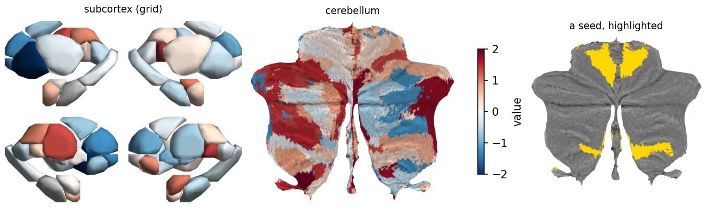
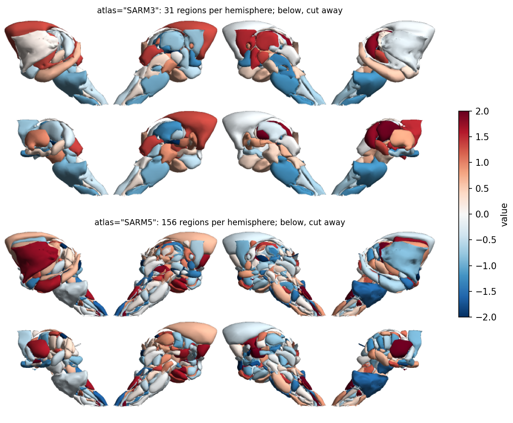
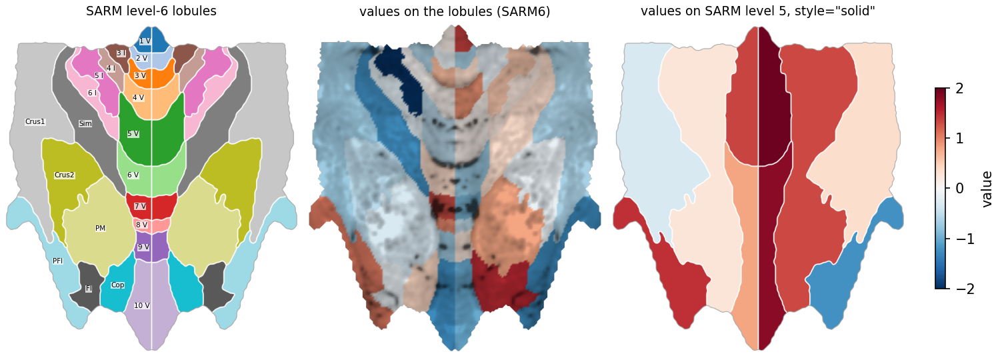

# scmaps

Subcortical and cerebellar brain maps in Python:

* the 32 ROIs of the **Tian S2** subcortical atlas (Melbourne Subcortex Atlas,
  Scale II), drawn as 3-D surfaces;
* the 32 regions of the **Nettekoven** asymmetric cerebellar atlas
  (NettekovenAsym32), drawn on **SUIT's flatmap**;
* for the **macaque**, the regions of **SARM** (levels 3 to 6) on surfaces
  built from the NMT v2.1-sym template: its subcortical regions as 3-D
  surfaces drawn as the human ones are, with cut-away views for the regions
  SARM nests (see [Macaque subcortex](#macaque-subcortex)), and its
  cerebellar regions (up to its 21 lobules per hemisphere) on a **macaque
  cerebellar flatmap** shaded as SUIT's is (see
  [Macaque cerebellum](#macaque-cerebellum)).

Either flatmap can also be drawn in a **solid** style: flat colours on light
grey, white lines between the regions, a grey outline
([Solid style](#solid-style)).

It is a port of MATLAB plotting code (`plotSubcortex.m`, and
`plotCerebellum.m` built on SUIT's `plotflatmap.m`). It uses the same surfaces,
views, scale, lighting and flatmap colour arithmetic, checked map by map
against the MATLAB renders. You don't need MATLAB, SPM or SUIT to run it; it
draws off-screen with VTK.



## Install

```bash
pip install git+https://github.com/alirzar/scmaps
```

Needs Python ≥ 3.10 and `numpy`, `matplotlib`, `nibabel` and `vtk`, which pip
installs for you.

## Use

```python
import numpy as np
import matplotlib.pyplot as plt
import scmaps

values = np.random.default_rng(0).normal(size=32)

# an RGBA image (H x W x 4 uint8, transparent background)
img = scmaps.subcortex_map(values, cmap="RdBu_r", vmin=-2, vmax=2, layout="grid")
img = scmaps.cerebellum_map(values, cmap="RdBu_r", vmin=-2, vmax=2)

# or drawn straight into matplotlib axes, with a ScalarMappable for the colourbar
fig, (a, b) = plt.subplots(1, 2)
sm = scmaps.plot_subcortex(values, ax=a, cmap="RdBu_r", vmin=-2, vmax=2)
scmaps.plot_cerebellum(values, ax=b, cmap="RdBu_r", vmin=-2, vmax=2)
fig.colorbar(sm, ax=[a, b])
```

**Values.** Pass 32 values in plotting order, or a mapping (a dict or a
pandas Series) from region name to value:

| | order | names |
|---|---|---|
| subcortex | left hemisphere's 16 ROIs, then the right's | `scmaps.SUBCORTEX_REGIONS`: `aHIP-lh`, `pHIP-lh`, … `pCAU-rh` |
| cerebellum | Nettekoven Asym32 labels 1–32 in the atlas's current numbering (1–16 left, 17–32 right) | `scmaps.CEREBELLUM_REGIONS`: `M1L` … `S5L`, `M1R` … `S5R` |

A region with NaN, or one missing from a mapping, has no value. It is drawn
grey on the subcortex (`nan_color`) and shows only the flatmap's grey underlay
on the cerebellum. Values outside `[vmin, vmax]` take the end colours. If you
leave out `vmin` / `vmax`, they default to the values' min and max.

**Cerebellar data in the atlas's original numbering.** Nettekoven atlas files
from before November 2023 number the regions differently: today's S5 was
named A4 and had label 8 (24 on the right), and D1–S4 had labels 9–16
(25–32). If your values were extracted with such a file, pass them by name
with `CEREBELLUM_REGIONS_ORIGINAL`:

```python
img = scmaps.cerebellum_map(dict(zip(scmaps.CEREBELLUM_REGIONS_ORIGINAL, values)))
```

**Colours instead of values.** Use `colors=`: one colour, 32 colours (`None`
for no value), or a mapping from name to colour. For example,
`scmaps.subcortex_map(colors={"aHIP-lh": "red"})`.

**Options**

| | subcortex | cerebellum |
|---|---|---|
| layout | `layout=`: `"grid"` (2 × 2), `"row"` (1 × 4), `"lateral"`, `"left"` | the flatmap |
| size | `dpi=` (default 300); each view is 1.2 in tall | `dpi=`; the canvas is 4 in square |
| highlight | `highlight=[names]`, `highlight_color=` (default gold) | the same, drawn without the underlay's shading (e.g. a seed) |
| other | `nan_color=` (default grey 0.82) | `alpha=` (default 0.75): how much underlay shading shows through, one value or one per region |
| style | | `style=`: `"suit"` (default) or `"solid"`; for solid, `nan_color=` (default grey 0.85), `border_color=` (white) and `outline_color=` (grey), `None` for no lines |
| atlas | `atlas=`: `"TianS2"` (default) or `"SARM3"` ... `"SARM6"` (macaque) | `atlas=`: `"NettekovenAsym32"` (default) or `"SARM3"` ... `"SARM6"` (macaque) |
| cut | `cut=True` (SARM): the layout's views again below, cut away | |

The renderers take RGB directly as well:
`scmaps.render_subcortex(rgbNx3, layout, dpi, atlas=..., cut=...)` and
`scmaps.render_cerebellum(rgbNx3, alphas, dpi, atlas=..., style=...)`.

## Solid style

```python
img = scmaps.cerebellum_map(values, style="solid", cmap="RdBu_r", vmin=-2, vmax=2)
```

The default style is SUIT's: the colours are blended with the flatmap's
shading. `style="solid"` draws the regions in flat colour on a light-grey
background, which is also the colour of a region without a value. White lines
separate the regions and a grey outline gives near-white colours an edge. The
canvas is the same as for the default style, so the two line up.

The borders are smoothed rather than drawn along the flatmap's triangles. Each
region's indicator is interpolated across the triangles and smoothed with a
Gaussian. Each point then goes to the region whose smoothed indicator is
largest. The smoothing is 0.76 units on the macaque flatmap, whose label
borders otherwise step along its grid; no lobule loses more than 5 % of its
area. On SUIT's flatmap it is 0.2 units, because that map has tiny regions
(D1R is 2 vertices) and every region is kept. The shapes are computed once
per atlas and drawn by matplotlib rather than VTK, so this style needs no
OpenGL.

## Macaque subcortex

```python
# SARM level 3: 31 regions per hemisphere, "SL_LPal" ... "SL_VMed", then "SR_..."
img = scmaps.subcortex_map(values, atlas="SARM3", layout="row", cut=True,
                           cmap="RdBu_r", vmin=-2, vmax=2)
scmaps.subcortex_regions("SARM5")   # the region names of a level, in plotting order
```

`atlas=` picks the parcellation and its surfaces: `"TianS2"` (human, the
default) or SARM's subcortex at level `"SARM3"` (31 regions per hemisphere),
`"SARM4"` (64), `"SARM5"` (156) or `"SARM6"` (180). Every SARM region of the
level is drawn except the cerebellum's (its cortex is on the
[cerebellar flatmap](#macaque-cerebellum); its nuclei and white matter would
cover the brainstem) and the pituitary. Names are SARM's, so values extracted
with SARM pass by name as they are. A mapping may hold the whole level: the
subcortical and the cerebellar map each pass over the regions they do not
draw. A name of another level, or not in SARM, is an error.

SARM's regions nest. From the side, the striatum hides the pallidum and the
thalamus, and the reticular thalamus wraps around the thalamus. `cut=True`
draws the layout's views again below the whole ones, cut away:

* the lateral views without the outer structures: lateral pallium, striatum,
  reticular thalamus, hippocampal formation, pallial amygdala, ventral
  pallium;
* the medial views without the midline ones: midline thalamus, diagonal
  subpallium, preoptic complex, tuberal and posterior hypothalamus, medial
  midbrain, fornix, epithalamus.

At levels 4 to 6 the cuts take every region inside those. Everything else
works as for the human map.



**How the surfaces are made** (`tools/build_macaque_subcortex.py`, from
AFNI's NMT v2.1-sym). They are built to read like the human surfaces, which
are MATLAB's `boundary(..., 0.5)` of Tian S2's 2 mm voxel centres: simple
shapes, two touching regions one voxel apart. The steps:

1. SARM's labels are taken to a 0.5 mm grid; each 2 × 2 × 2 block of the
   0.25 mm template takes its most frequent label.
2. Every region's surface is extracted at once with surface nets (VTK).
3. Each surface is smoothed and simplified to 15 % of its triangles.
4. Each surface is pulled in half a voxel, so touching regions sit 0.5 mm
   apart.

The right hemisphere is the left's mirror image; the template is symmetric.

The 0.5 mm grid is coarse enough for simple shapes and fine enough for level
5's small nuclei, which break into shards on 1 mm. Surface nets keeps the
regions' shapes, where `boundary()`'s alpha shape would fill them in: the
striatum, the fornix and the reticular thalamus become blobs. The surfaces
place the regions; they are not the template's exact boundaries. Unlike the
human map, this one has no MATLAB render to be checked against.

## Macaque cerebellum

```python
# SARM level 6: 21 lobules per hemisphere, "SL_Cb1V" ... "SL_Fl", then "SR_..."
img = scmaps.cerebellum_map({"SL_Cb6V": 1.2, "SR_Cb6V": 0.8}, atlas="SARM6",
                            cmap="RdBu_r", vmin=-2, vmax=2)
scmaps.cerebellum_regions("SARM5")   # the region names of a level, in plotting order
```

`atlas=` picks the parcellation and with it the flatmap: `"NettekovenAsym32"`
(human, the default) or SARM's cerebellar cortex at level `"SARM3"` (the whole
cortex), `"SARM4"` (vermis, intermediate, lateral, flocculus and
paraflocculus), `"SARM5"` (the vermis split into anterior and posterior) or
`"SARM6"` (the lobules: vermis I–X, intermediate 3–6, simple, crus I and II,
paramedian, copula, paraflocculus, flocculus). Names are SARM's, with its
hemisphere prefixes, so values extracted with SARM pass by name as they are.
Everything else works as for the human map, `style="solid"` included. The
example below draws the lobules and the level-5 values in the solid style.



**How the flatmap is made** (`tools/build_macaque_flatmap.py`, from AFNI's NMT
v2.1-sym distribution). The cerebellar cortex is the grey matter of the
template's tissue segmentation inside SARM's level-6 lobules. In each sagittal
slab the lobules fan out around the cerebellum's core: the fastigial nucleus
near the midline, the slab's white matter and deep nuclei further out. Each
grey-matter point is placed by its mediolateral position and its angle around
that core, from lobule I over the top and the back down to lobule X and the
(para)flocculus, the angle turned into a length along the cerebellar surface.
A regular grid over the points is the flatmap (23,772 vertices); each vertex
takes the majority lobule of its nearest points, and the right hemisphere is
the left's mirror image (the template is symmetric). The underlay is the depth
below the cerebellum's outer envelope (dark where a fissure opens), given
SUIT's underlay distribution so the shading reads as on the human map. SARM's
coarser levels label each vertex by its lobule's parent region.

So the map keeps SARM's lobules, their order and their neighbours, laid out
as SUIT's flatmap lays out the human cerebellum (vermis down the middle,
anterior lobe at the top). Unlike SUIT's, it does not unfold the folia: cortex
buried in a fissure shares the place of the surface above it, so a lobule's
flat area is that of its outer envelope, not of its whole cortical sheet. It
shows regional values; it is not a map for projecting voxel data at folial
resolution.

## How it matches MATLAB

* **Subcortex.** Uses the ROI surfaces of MATLAB's `boundary(..., 0.5)`. The
  views are tiled edge to edge at one scale and drawn with orthographic side
  views. The lighting is MATLAB's own, computed per vertex and interpolated
  across each triangle, as `lighting gouraud` does it:
  * vertex normals are the sum of the adjacent faces' unit normals;
  * back faces are lit with `'reverselit'`;
  * the light is a local `camlight` 30° right and 30° up of the camera;
  * the material is `dull` (0.3 ambient + 0.8 diffuse).

  These constants were measured on figures that MATLAB R2024b made.
* **Cerebellum.** `plotflatmap.m`'s arithmetic:
  * the underlay is shown through `gray(256)` on [-1, 0.5];
  * the overlay is blended as `colour × ((1 − α) + α × underlay)`;
  * colours are interpolated across each triangle.

Against the MATLAB renders of 60 maps, the silhouettes agree at
IoU ≥ 0.995 (subcortex) and ≥ 0.998 (cerebellum). The mean colour difference
is ≤ 0.008 and ≤ 0.004 on a 0–1 scale. `tests/test_render.py` checks this
against two stored MATLAB renders.

## Headless use

VTK renders off-screen, but it still needs an OpenGL implementation. On a
Linux server or in CI without a display, use VTK ≥ 9.4, which falls back to
EGL or OSMesa. Otherwise, install OSMesa (`libosmesa6`) or run under
`xvfb-run`. The cerebellum's solid style does not use VTK.

## Development

```bash
pip install -e ".[test]"
pytest
```

`tools/convert_resources.py` regenerates the `.npz` atlas files in
`src/scmaps/data/` from their sources in `tools/source/`, and checks
that the conversion is lossless.

## Citing

If you use scmaps in a publication, please cite the atlases and tools it
draws. The Melbourne Subcortex Atlas licence requires the Tian et al. citation,
and the other sources ask for attribution. Full references are in `NOTICE`.

* **Subcortex:** Tian Y, Margulies DS, Breakspear M, Zalesky A (2020).
  Topographic organization of the human subcortex unveiled with functional
  connectivity gradients. *Nature Neuroscience* 23: 1421–1432.
* **Cerebellar parcellation:** Nettekoven C, et al. (2024). A hierarchical
  atlas of the human cerebellum for functional precision mapping. *Nature
  Communications* 15: 8376.
* **Flatmap:** Diedrichsen J, Zotow E (2015). Surface-based display of
  volume-averaged cerebellar imaging data. *PLoS ONE* 10(7): e0133402.
  Also Diedrichsen J (2006), *NeuroImage* 33(1): 127–138, for the SUIT
  template, and Wang Y, et al. (2026), *Imaging Neuroscience* 4,
  IMAG.a.1323, for SUITPy, the source of the flatmap files.
* **Macaque subcortex and cerebellum:** Hartig R, et al. (2021). Subcortical
  Atlas of the Rhesus Macaque (SARM) for neuroimaging. *NeuroImage* 235:
  117996; and Jung B, et al. (2021). A comprehensive macaque fMRI pipeline
  and hierarchical atlas. *NeuroImage* 235: 117997, for the NMT v2 template
  the surfaces and the flatmap are built from.

## Licence

The scmaps code is MIT (`LICENSE`). The bundled atlas data stays under the
terms of its sources (`NOTICE`):

| data | licence |
|---|---|
| SUIT flatmap and underlay | MIT with an acknowledgement clause, from SUITPy (`LICENSES/SUITPy.txt`) |
| Nettekoven cerebellar labels | CC BY (attribution) |
| Tian S2 subcortical surfaces | Melbourne Subcortex Atlas License: free use and distribution; publications must cite Tian et al. (2020) |
| macaque subcortical surfaces, flatmap, underlay and SARM labels | derived from AFNI's NMT v2.1-sym and its SARM; please cite Hartig et al. (2021) and Jung et al. (2021) |
